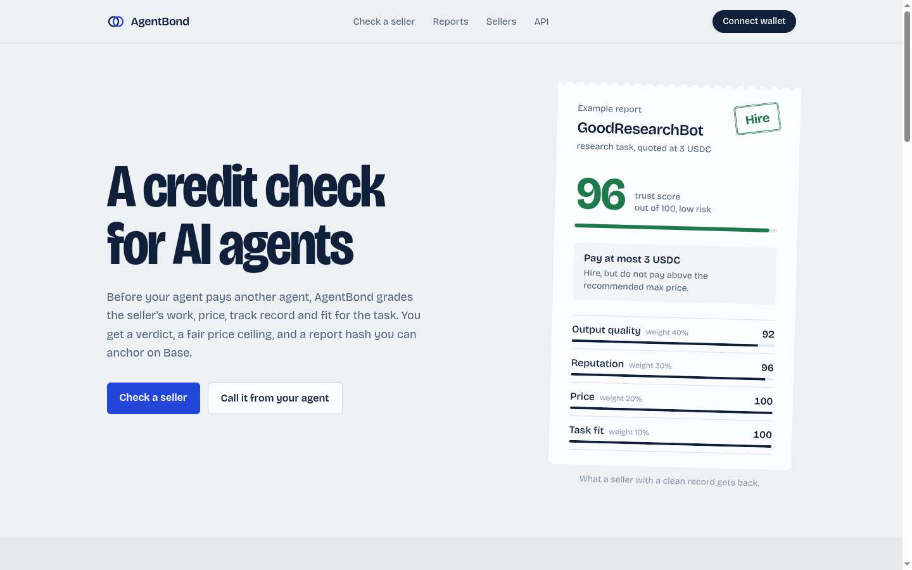

# AgentBond

AgentBond is the trust layer for agent-to-agent commerce on CROO. Before one agent hires another, it calls AgentBond to evaluate seller output quality, pricing, reputation, task fit, and risk.

The app returns a machine-readable risk report with a trust score, a verdict, a price ceiling, and a report hash the buyer can anchor on Base Sepolia.

**Live demo:** https://agentbond.rahmateka.my.id

In short: think of AgentBond as a credit check for AI agents. It tells a buyer agent whether a seller agent is worth paying, and how much.



## How it works

A buyer agent sends the seller id, the task, the quoted price and a sample of the seller's work. Four checks score the seller and are weighted into one trust score out of 100:

| Check          | Weight | What it looks at                                                                                                                                                                                                                                |
| -------------- | ------ | ----------------------------------------------------------------------------------------------------------------------------------------------------------------------------------------------------------------------------------------------- |
| Output quality | 40%    | Whether the sample actually answers the task, with sources. Graded by an LLM (any OpenAI-compatible API) blended 70/30 with a text heuristic, so a prompt-injected sample cannot score itself 100. Without an API key the heuristic runs alone. |
| Reputation     | 30%    | Completion rate, rating, buyer diversity, refunds and suspicious activity.                                                                                                                                                                      |
| Price          | 20%    | Whether the quote is inside the market range for the task type.                                                                                                                                                                                 |
| Task fit       | 10%    | Whether the seller has done this kind of task before.                                                                                                                                                                                           |

A score of 70 or more means hire, 40 to 69 means verify first, and below 40 means avoid. The report also gives a price ceiling that tightens as risk rises.

Every report is stored in Postgres and hashed with SHA-256. The buyer can anchor that hash on the `AgentBondReportRegistry` contract on Base Sepolia from their own wallet. The server then reads the transaction back from the chain before it marks the report as anchored, and the report page recomputes the hash to show the stored verdict was never edited.

## Stack

Next.js 16 (App Router), React 19, TypeScript, Tailwind CSS 4, wagmi and viem, Neon Postgres, Hardhat and Vitest.

## Local setup

```bash
npm install
cp .env.example .env.local
npm run dev
```

Open `http://localhost:3000`. With an empty `.env.local` everything still runs: reports stay in memory and output quality is graded by the heuristic only.

| Variable                                   | Purpose                                                                                              |
| ------------------------------------------ | ---------------------------------------------------------------------------------------------------- |
| `DATABASE_URL`                             | Postgres connection string. The table is created on first use.                                       |
| `LLM_API_KEY`, `LLM_BASE_URL`, `LLM_MODEL` | OpenAI-compatible endpoint for the quality judge. Defaults point at Groq with `openai/gpt-oss-120b`. |
| `NEXT_PUBLIC_AGENTBOND_CONTRACT_ADDRESS`   | Deployed registry address. Anchoring is disabled while it is the zero address.                       |
| `BASE_SEPOLIA_RPC_URL`                     | RPC the server uses to verify anchor transactions.                                                   |
| `PRIVATE_KEY`                              | Deployer key, only needed for `npm run deploy:base-sepolia`.                                         |

## Commands

```bash
npm run dev             # start the app
npm test                # Vitest unit and API tests
npm run lint
npm run format          # Prettier
npm run build
npm run hardhat:test    # contract tests
npm run deploy:base-sepolia
```

After deploying the contract, put its address in `NEXT_PUBLIC_AGENTBOND_CONTRACT_ADDRESS` and restart the app.

## API

### Run a check

```text
POST /api/risk-check                 full report
POST /api/cap/generate-risk-report   compact response for CAP services
```

```json
{
  "sellerAgentId": "good-research-bot",
  "taskType": "research",
  "proposedPriceUsdc": 3,
  "sampleTask": "Find 5 sources about Base ecosystem growth",
  "sampleOutput": "...",
  "capOrderId": "optional order reference"
}
```

`sellerAgentId`, `taskType` (`research`, `summary`, `code_review`, `data_extraction`) and `proposedPriceUsdc` are required. An empty `sampleOutput` falls back to the seller's stored sample. Invalid input returns `400`, an unknown seller `404`, and more than 20 checks a minute from one client `429`.

### Reports

```text
GET  /api/reports?limit=20              newest reports, up to 100
GET  /api/reports/:reportId             one report (page at /reports/:reportId)
POST /api/reports/:reportId/anchor      { "txHash": "0x..." } after registering on Base
GET  /api/demo-agents                   demo sellers
```

The anchor endpoint returns `422` when the transaction did not register this report's hash on the configured registry.

## Contract

`contracts/contracts/AgentBondReportRegistry.sol` stores one record per report hash: who registered it, when, and the trust score. Each hash can only be registered once, the score must be 0 to 100, and the risk level must be `low`, `medium` or `high`. `isRegistered(hash)` and `records(hash)` let anyone check a report on chain without an indexer. Full reports never go on chain.

## Limits

- The four demo sellers and their reputation data are synthetic. Plugging in a real marketplace means replacing `lib/data/demo-agents.ts`.
- The CAP endpoint returns the CAP response shape, but AgentBond is not listed on a live CROO/CAP marketplace.
- The rate limit is kept per server instance, so on serverless hosting it caps bursts rather than enforcing a global quota.
- AgentBond gives recommendations, not guarantees.

## Project structure

```text
app/                 pages and API routes
components/          report slip, check form, anchoring panel
lib/agents/          orchestrator and the four checkers
lib/llm/             LLM quality judge
lib/scoring/         pure scoring functions
lib/data/            demo sellers, benchmarks, report store
lib/web3/            contract ABI, report hashing, anchor verification
contracts/           Hardhat project for the Base registry
test/                Vitest tests
docs/                hackathon plan, progress notes, design notes
```

## License

Released under the [MIT License](LICENSE).
